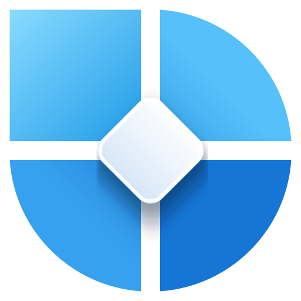
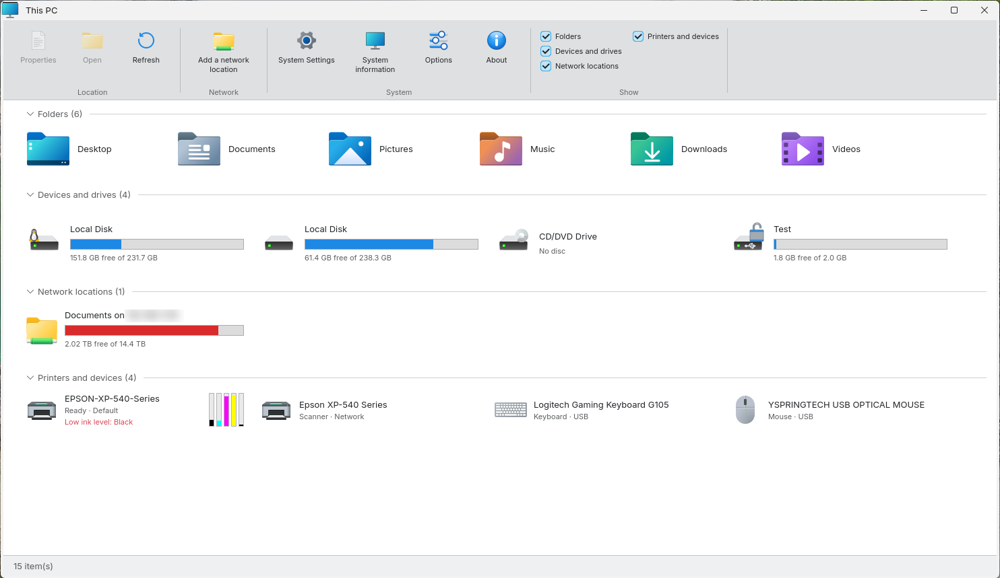

<p align="center">
  
</p>

<h1 align="center">Fenestra This PC</h1>

<p align="center">A "This PC" window for KDE Plasma 6, inspired by the Windows 11 view of the same name.<br>Part of the Fenestra series.</p>

It shows, in one window, your personal folders, your drives, your network locations, your printers and your input devices. It follows the colours and the icon theme of your Plasma desktop.



> **Version 2.1 is a Plasma component.** If you have an older version (1.x) installed, it is uninstalled for you by the install script (your settings are kept). After downloading, run `bash install.sh` once. From then on, **updates are offered by Discover**, with your other updates.

## Features

- **Folders**: Desktop, Documents, Pictures, Music, Downloads and Videos, opened in Dolphin.
- **Devices and drives**
  - Internal disks, USB sticks, memory cards and external disks, each with a usage gauge. The gauge turns red when the free space falls below a level you choose in **Options** (20 % by default, down to 10 %).
  - Your CD/DVD drive is always shown, even when empty, and it can be ejected.
  - Disk health is watched for you: an orange badge and "Signs of wear" appear under the gauge when a disk reports bad sectors or a failing SMART attribute, a red badge and "Disk failing – back up your files" when it predicts its own failure. Nothing is shown for a healthy disk. No password is asked: the state comes from udisks2.
  - An open padlock marks an unlocked encrypted (LUKS) volume. A locked container is not shown.
  - Right-click → **Format…** opens a Windows 11-style window: exFAT, FAT32, NTFS or ext4, volume name, quick or full format, progress bar, and Cancel during a full format. Every volume can be formatted except the ones the system needs (`/`, `/boot`, `/boot/efi`, `/home`, `/usr`, `/var` and swap). The administrator password is asked.
- **Disk properties**: a separate window you can move and keep open, with three tabs.
  - **General**: type, brand, model, firmware, serial number (hidden until you click the eye), file system, mount point, device, and a usage ring. Buttons to open the volume in Dolphin and to analyse its space with Filelight (when installed). USB volumes can be renamed.
  - **Health**: overall state (good, signs of wear, failing), remaining lifetime (the bar starts full and empties with wear), available spare, data errors or bad sectors, power-on time, power cycles, unexpected shutdowns, data written and read, temperature. Quick and full self-tests with a progress bar. Disks in a USB enclosure can be read through the enclosure (administrator password, needs `smartctl`), and can run the self-tests too. The full SMART report is one click away.
  - **Surface**: a read-only scan of every sector, shown as a map of 1,000 squares (normal, slow, damaged), with the number of sectors, speed and time left. Nothing is ever written to the disk. The administrator password is asked.
- **Network locations**
  - Add an SMB share (NAS, another computer) with a button. You don't need a terminal or administrator rights.
  - The share shows its free space. Its password is kept in KWallet.
  - When the server is off, the share stays listed with a red badge.
- **Printers and devices**
  - Each printer shows its state (Ready, Printing, Offline), whether it is the default printer, and its ink levels: one small bar per cartridge on the card itself, and the details in its own window, with the ink names translated and, for a network printer, its IP address. A fixed line such as "Low ink level: Black" appears when a cartridge falls below the level the printer declares.
  - The state reflects whether a network printer really answers, not only what CUPS believes.
  - A known printer that is switched off stays listed as Offline, and you can remove it from the list.
  - Scanners have their own card ("Scanner · Network" or "Scanner · USB"). Clicking the card opens Skanpage, the KDE scanning app, when it is installed. If it is not, the message offers to search for it in Discover.
  - For your safety, a network scanner is only shown when it belongs to a printer installed on this PC: the scanners of other people on the same Wi-Fi (hotel, office…) stay hidden.
  - Keyboards, mice, touchpads, graphics tablets and game controllers are listed with their connection (USB, Bluetooth, built-in).
- **Ribbon**: Location, Network and System commands, and a **Show** group with one tick box per section. Untick a section to hide it. A **compact toolbar** (the same commands as icons only, with the section choices in a "…" menu) can be chosen in Options.
- **Options**: open items with a single click (linked both ways to the Plasma setting, so it also applies to Dolphin and the desktop), free space alert level, compact toolbar. (The weekly version check is only shown when updates do not go through Discover.)
- **Your choice is kept**: each section remembers whether it is folded or hidden, and the window remembers its size. The lists show instantly on opening.
- **Updates**: from version 2.1, **Discover offers the new versions** with your other updates. If it does not, This PC checks GitHub at most once a week and shows a banner with a "View" button telling you to download the new version and run `bash install.sh` again. Nothing is installed automatically. You can turn this check off in Options.
- **Languages**: 14 languages, following your system language, with English as the fallback.

## Requirements

- KDE Plasma 6 (Qt 6), Wayland session. X11 is not supported.
- Python 3 with PyQt6, including the QtQml and QtQuick modules, and Kirigami.
- Required tools: `lsblk`, `udevadm`.
- Optional tools, each one enabling a feature:
  - `udisksctl` and `eject`: CD/DVD mounting and ejecting.
  - `smartctl` (smartmontools): full SMART report, health and self-tests of disks in a USB enclosure.
  - `pkexec` (polkit): surface scan and USB self-tests.
  - `exfatprogs`, `dosfstools`, `ntfs-3g` (or ntfsprogs), `e2fsprogs`: formatting in exFAT, FAT32, NTFS, ext4. A missing format is shown in red with the name of the missing tool.
  - `smbclient`: network shares.
  - `lpstat` (CUPS): printers.
  - `ipptool` (CUPS IPP tools): ink levels.
  - `avahi-browse` (Avahi tools): real printer status.
  - `kwallet-query`: remembered passwords.
  - `busctl` and udisks2: disk health, self-tests, formatting.
  - `scanimage` (SANE): scanners.
  - `skanpage`: scanning from the scanner card.
  - `plasma-discover`: the "Search in Discover" button when Skanpage is missing.

On Kubuntu 26.04 and Fedora KDE everything is already installed. The install script checks what is present before installing anything.

If optional tools are missing, the install script lists them with the feature each one enables, shows the exact command for your distribution (Solus, Fedora, Debian/Ubuntu, Arch, openSUSE) and asks before installing them. Packages are installed one by one, so a package missing on your distribution does not stop the others. Nothing is installed without your agreement. Applications (Skanpage, Filelight) are only suggested, never installed.

If PyQt6 or its QML modules are missing, the install script shows the exact command for your distribution (Solus, Fedora, Debian/Ubuntu, Arch, openSUSE) and offers to run it for you. Install PyQt6 from your distribution, not with `pip`: pip brings its own copy of Qt, which cannot use your desktop's Kirigami.

## Installation

**Option 1 — KDE Store.** Download Fenestra This PC from the KDE Store, then run the install script once, in the folder where it was extracted:

```
bash install.sh
```

**Option 2 — from this repository.** Download or clone it, then, in the folder:

```
bash install.sh
```

The script installs for the current user only (no root needed). It:

- looks for an older version (1.x or 2.0): if it finds one, it says so and asks before uninstalling it (answer `n` and nothing is changed; your settings are kept);
- checks the requirements and offers to install what is missing;
- installs the Plasma component `org.fenestra.cepc` in `~/.local/share/plasma/plasmoids/`, with the program, its icons and its languages inside it;
- adds a "This PC" entry to the application menu;
- puts a "This PC" shortcut on the desktop (use `bash install.sh --no-desktop-icon` if you don't want it);
- sets up the updates through Discover.

**Updating.** Discover offers the new versions of This PC, like those of your other add-ons. To update by hand, download the new version and run `bash install.sh` again. Your settings are kept (network locations, window size, sections, printers).

To remove it:

```
bash uninstall.sh            # keeps your settings
bash uninstall.sh --purge    # also removes settings and caches
```

## Appearance

This PC uses your Plasma colours and your icon theme, so its look changes with your theme: with another icon theme (Breeze, for example), it will look different from the screenshots. The screenshots were taken with the **windows-modern** icon theme from [Windows Modern for KDE Plasma 6](https://github.com/Jeysef/KDE-Windows-Modern) (by Jeysef, based on [Win11OS-kde](https://github.com/yeyushengfan258/Win11OS-kde) by yeyushengfan258), which is not included here.

## Languages

English, French, German, Spanish, Italian, Portuguese (Portugal), Brazilian Portuguese, Dutch, Polish, Russian, Turkish, Japanese, Simplified Chinese and Traditional Chinese.

English and French are written by the author. The other languages were translated with the help of an AI and still need a review by native speakers. Corrections are welcome.

## Known limitations

- **Printer states come from CUPS.**
  - A printer detected automatically on the network is a temporary queue. It disappears when the printer is switched off, and CUPS then forgets that it was the default printer.
  - Installing the printer in *Printer Settings* gives a permanent queue that keeps this setting.
- **Low ink alert.** The level that triggers "Low ink level" is the one your printer declares (`marker-low-levels`); This PC does not decide it and cannot change it. If the printer declares none, 10 % is used. A printer that does not report its ink levels shows no ink bars.
- **Real printer status needs `avahi-browse`.** Without it, the state shown is the one reported by CUPS.
- **Disk health** is read automatically for internal SATA and NVMe disks. A disk in a USB enclosure is read on request, if the enclosure passes the information on. USB sticks and memory cards do not report it.
- **Self-tests:** after a test, the system (udisks2) can keep the disk busy for up to a minute; the progress bar includes this time. Data written is not shown for SATA disks, because each brand counts it differently.
- **Encryption** is not managed here: it will be part of a separate Fenestra security centre.
- **Password windows** (self-tests, surface scan, formatting) belong to the system, not to This PC: their text comes from udisks2 and polkit. On some systems the NVMe self-test message is still in English, because udisks2 has not translated it yet. This PC cannot change that text.
- **Scanners:** searching the network takes about 10 seconds, so it runs in the background (at start-up, then every 10 minutes or on "Refresh"). A scanner whose printer is not installed on this PC is not shown.
- **Battery levels** of wireless mice and keyboards are not shown yet.
- **Input devices:** only keyboards, mice, touchpads, graphics tablets and game controllers are listed. Screens, cameras and audio devices are not.
- **Tested on:** Solus (Plasma 6), Fedora KDE 44, Kubuntu 26.04 LTS, openSUSE and Manjaro. Feedback from other distributions and other printer brands is welcome.

## Contents

| Path | Description |
|---|---|
| `metadata.json` | Description of the Plasma component |
| `contents/ui/main.qml` | The component: icon that opens the window |
| `contents/code/ce_pc_plasma.py` | The program |
| `contents/code/shortcut.sh` | Menu entry and desktop shortcut |
| `contents/code/store_registry.py` | Helper for the updates through Discover |
| `contents/icons/` | Compact toolbar icons (Fluent UI System Icons) and their licence, the Fenestra logo and the icons drawn for Fenestra (padlock, options, about, removable disk) |
| `contents/locale/` | Translations (gettext `.po` and compiled `.mo`) |
| `docs/` | Images used by this README (logo as a 512 px PNG, with its SVG source); not installed |
| `install.sh` / `uninstall.sh` | Installation and removal for the current user |
| `CHANGELOG.md` | What changed in each version |
| `LICENSE` | GNU General Public License v3.0 |

## Credits

- This PC © 2026 naykkalak, Fenestra series.
- Compact toolbar icons: Fluent UI System Icons © Microsoft Corporation, MIT licence (see `contents/icons/`).
- Padlock, options, about and Fenestra logo icons: drawn for Fenestra. The removable-disk icon derives from the drive icon of the windows-modern theme (GPL-3.0).
- Icon theme used for the screenshots: windows-modern, from [Windows Modern for KDE Plasma 6](https://github.com/Jeysef/KDE-Windows-Modern) by Jeysef, based on Win11OS-kde by yeyushengfan258. It is not included in this repository.

## Privacy

This PC sends nothing about you. When the updates go through Discover (the default after `install.sh`), it makes no request of its own: Discover handles them. Otherwise, the only request it makes on its own is the weekly version check: it asks GitHub for the number of the latest release. As with any visit to a website, GitHub sees your IP address. Untick "Check for a new version once a week" in Options to stop it.

## Related projects

**DriveDeck** is an independent fork of This PC made by another author, with its own features and its own version numbers (it also uses 2.0.x). It is not part of the Fenestra series and this repository does not contain its code.

## Trademarks

This project is not affiliated with, endorsed by or sponsored by Microsoft Corporation. Windows is a trademark of Microsoft Corporation.

## License

This PC is licensed under the GNU General Public License v3.0 or later (GPL-3.0-or-later). See `LICENSE`.

The Fluent UI System Icons in `contents/icons/compact/` keep their own MIT licence. The icons drawn for Fenestra follow the licence of this project, except the removable-disk icon, which derives from the windows-modern theme and keeps its licence (GPL-3.0).
